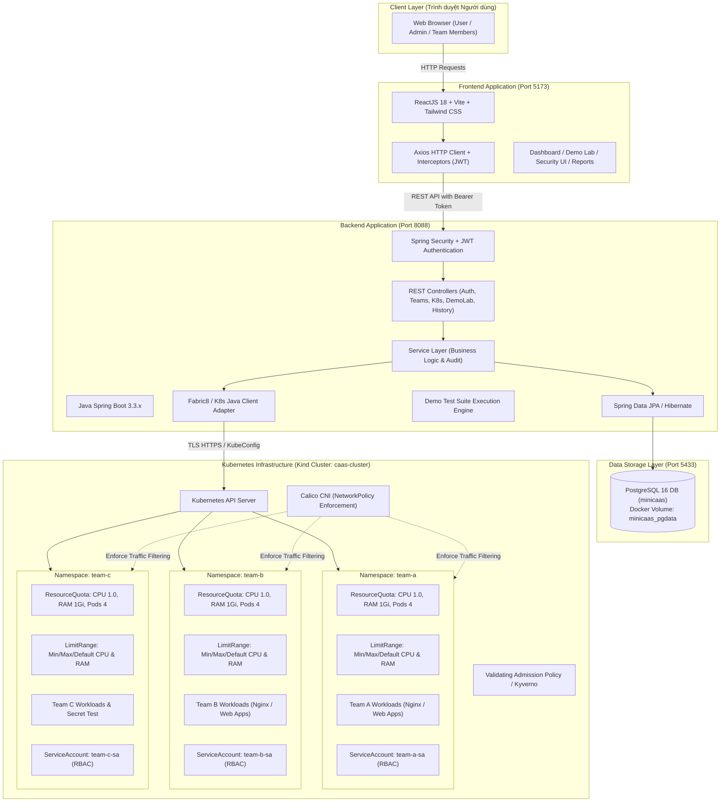
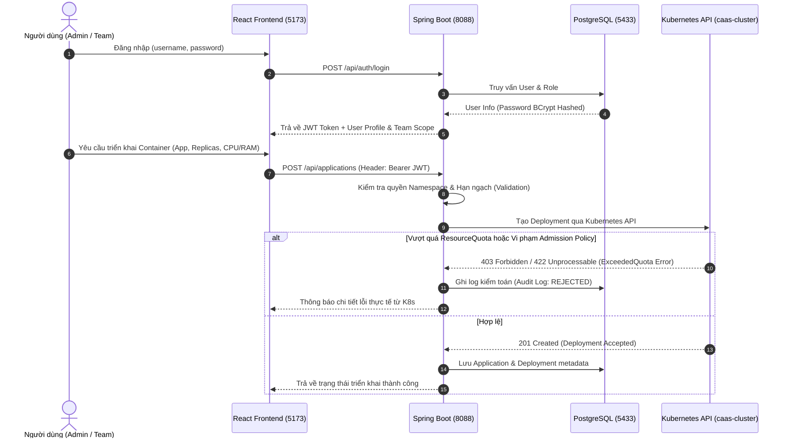

# MINI CAAS PLATFORM – KIẾN TRÚC HỆ THỐNG

## 1. TỔNG QUAN HỆ THỐNG

**Mini CaaS Platform** (Container as a Service) là nền tảng quản trị và cô lập tài nguyên điện toán đám mây cho nhiều nhóm phát triển (Multi-tenant) hoạt động trên cùng một Kubernetes Cluster.

Nền tảng đảm bảo 4 trụ cột cô lập chính:
1. **Cô lập không gian tên (Namespace Isolation)**: Phân vùng logic giữa các nhóm `team-a`, `team-b`, `team-c`.
2. **Cô lập & Kiểm soát tài nguyên (Resource Governance)**: Sử dụng `ResourceQuota` (tổng CPU/RAM) và `LimitRange` (giới hạn min/max/default cho mỗi Container).
3. **Cô lập phân quyền truy cập (Access Control - RBAC)**: Mỗi nhóm sở hữu `ServiceAccount`, `Role`, `RoleBinding` riêng biệt; tuân thủ nguyên tắc đặc quyền tối thiểu (Least Privilege).
4. **Cô lập giao tiếp mạng (Network Isolation)**: Sử dụng Calico CNI triển khai `NetworkPolicy` mặc định chặn toàn bộ giao tiếp giữa các Namespace (Default Deny Ingress) và chỉ cho phép lưu thông khi có chính sách phê duyệt cụ thể.
5. **Kiểm soát đầu vào (Admission Control)**: Ngăn chặn triển khai Container Image không thuộc whitelist được cấp phép hoặc thiếu cấu hình tài nguyên.

---

## 2. SƠ ĐỒ KIẾN TRÚC TỔNG THỂ

---

## 3. CƠ CHẾ ĐẢM BẢO KHÔNG TRÙNG LẶP & CÔ LẬP CỔNG

Để bảo đảm hoạt động độc lập và không can thiệp vào các dự án khác trên máy tính:

| Thành phần | Cổng Host | Cổng Container/Internal | Giao thức | Mô tả |
|---|---|---|---|---|
| **Mini CaaS Frontend** | `5173` | `5173` | HTTP | Vite Development Server |
| **Mini CaaS Backend** | `8088` | `8088` | HTTP | Spring Boot REST API |
| **Mini CaaS PostgreSQL** | `5433` | `5432` | TCP | Dedicated PostgreSQL container (`minicaas-postgres`) |
| **Kind Control Plane** | Dynamic / Internal | `6443` | HTTPS | K8s API Server quản lý bởi Kind |

*Các dịch vụ của dự án Hotel Booking đang sử dụng cổng `3000`, `8080`, `5432` hoàn toàn độc lập và không bị ảnh hưởng.*

---

## 4. LUỒNG XỬ LÝ DỮ LIỆU VÀ BẢO MẬT

