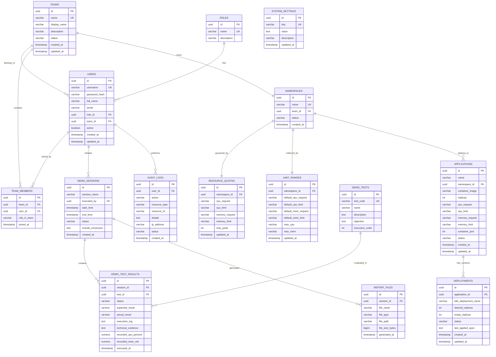

# MINI CAAS PLATFORM – THIẾT KẾ CƠ SỞ DỮ LIỆU (DATABASE ERD & SCHEMA)

## 1. NGUYÊN TẮC THIẾT KẾ DATABASE

1. **Phân định rõ ràng hai nguồn dữ liệu**:
   - **PostgreSQL Database**: Lưu trữ dữ liệu cấu hình ứng dụng, tài khoản người dùng, phân quyền truy cập, các phiên DEMO, kết quả bài kiểm thử, lịch sử kiểm toán và cấu hình báo cáo. Dữ liệu này **tồn tại vĩnh viễn** qua Docker Volume `minicaas_pgdata`.
   - **Kubernetes Live State**: Trạng thái thực tế tức thời của cụm K8s (Pods đang chạy, CPU/RAM thực tế từ Metrics Server, trạng thái NetworkPolicy). Database không thay thế Kubernetes mà bổ trợ và ghi lại lịch sử hoạt động.
2. **Bảo mật dữ liệu**:
   - Mật khẩu được mã hóa an toàn bằng thuật toán **BCrypt** (Cost factor 10).
   - Tuyệt đối không lưu trữ thông tin nhạy cảm của Kubernetes như Secret values, Private Keys hay Token ServiceAccount trong Database.
3. **Audit Trail**: Mọi bảng quan trọng đều có `created_at`, `updated_at`, `created_by` để phục vụ truy vết.

---

## 2. SƠ ĐỒ THỰC THỂ LIÊN KẾT (MERMAID ERD)

---

## 3. CÁC INDEX VÀ RÀNG BUỘC TỐI ƯU TRUY VẤN

- **Index `idx_users_username`**: Đảm bảo tốc độ tra cứu khi xác thực đăng nhập `O(1)`.
- **Index `idx_demo_results_session`**: Tăng tốc truy vấn toàn bộ bài test của một phiên DEMO.
- **Index `idx_audit_logs_action_date`**: Phục vụ bộ lọc tìm kiếm lịch sử theo mốc thời gian và hành vi.
- **Index `idx_apps_namespace`**: Lọc nhanh các ứng dụng thuộc từng Namespace.
